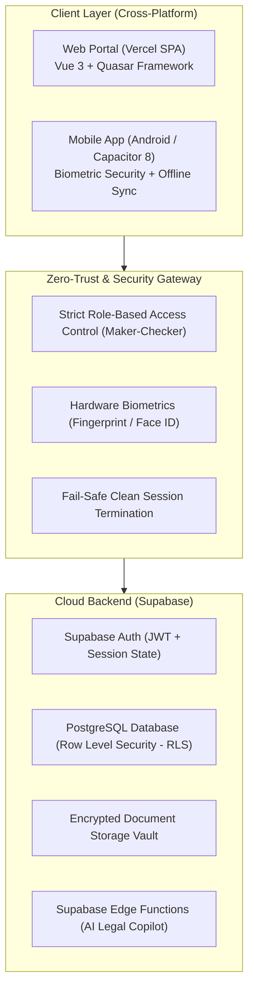
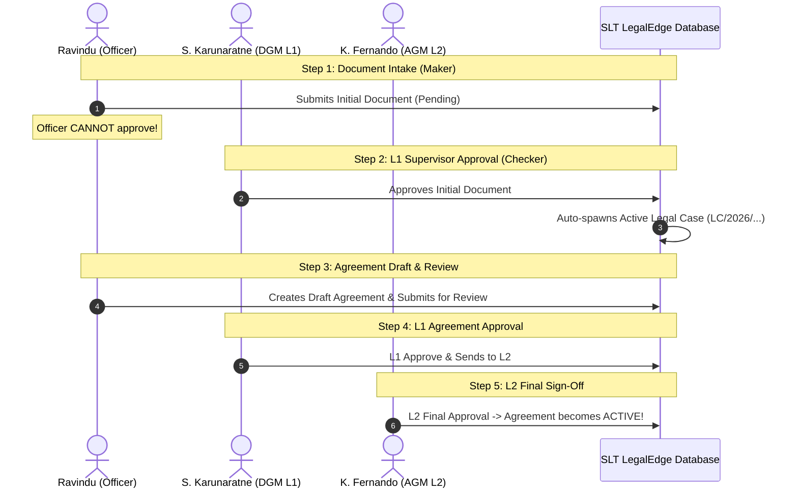

# SLT LegalEdge: ඒකාබද්ධ නීති කළමනාකරණ පද්ධතිය (Definitive System Manual)
> **කණ්ඩායම:** NEXGEN CREATORS  
> **ආයතනය:** Sri Lanka Telecom PLC (Legal Division)  
> **පද්ධති අනුවාදය:** v1.0.0 Production Ready  
> **සජීවී වෙබ් ද්වාරය:** [https://slt-legaledge.vercel.app](https://slt-legaledge.vercel.app)  
> **Git Repository:** [https://github.com/ravindu84/SLT-LegalEdge---Integrated-Legal-Management-System.git](https://github.com/ravindu84/SLT-LegalEdge---Integrated-Legal-Management-System.git)

---

## 1. විධායක සාරාංශය සහ තාක්ෂණික ව්‍යුහය (Architecture & Tech Stack)

**SLT LegalEdge** යනු ශ්‍රී ලංකා ටෙලිකොම් ආයතනයේ නීති අංශයේ සමස්ත නඩු කටයුතු (Litigation Management), ගිවිසුම් ජීවන චක්‍රය (Contracts & Agreements Lifecycle), බහු-මට්ටමේ ලේඛන අනුමැතිය (Multi-level Approvals) සහ මූල්‍ය අවදානම් අධීක්ෂණය (Financial Exposure Monitoring) 100% ක් ස්වයංක්‍රීයව මෙහෙයවීම සඳහා නිර්මාණය කරන ලද Enterprise මට්ටමේ ඩිජිටල් පරිසර පද්ධතියකි.



### තාක්ෂණික සංරචක (Technology Stack):
1. **Frontend Core:**
   * **Vue 3:** Modern Composition API (`<script setup>`) පදනම් කරගත් ප්‍රතික්‍රියාශීලී (reactive) අතුරුමුහුණත.
   * **Quasar Framework (v2.18+):** Material Design සහ Executive Fintech මට්ටමේ responsive UI සංරචක.
   * **Pinia:** State management සඳහා (Auth, Notifications, Offline Sync).
   * **Vue Router 4:** SPA History mode (Vercel URL rewrites සමඟ).
   * **Chart.js & Vue-Chartjs:** අධිකරණ සහ ගිවිසුම් දත්ත විශ්ලේෂණ ප්‍රස්ථාර (Doughnut, Bar, Trendlines).
   * **Vue-i18n:** භාෂා ත්‍රිත්ව සහාය (English, සිංහල, தமிழ்).

2. **Backend & Data Tier:**
   * **Supabase (Managed PostgreSQL):** Relational tables, Foreign keys, Complex triggers සහ Audit logs.
   * **Row Level Security (RLS):** Database මට්ටමේදීම අනවසර දත්ත ප්‍රවේශය වැළැක්වීම.
   * **Storage Buckets:** නඩු ලියකියවිලි, සාක්ෂි සහ ගිවිසුම් PDF ගබඩා කිරීම.

3. **Mobile Ecosystem:**
   * **Capacitor 8:** Web codebase එක කෙලින්ම Native Android/iOS යෙදුමක් බවට පත් කිරීම.
   * **Native Biometric Auth:** Fingerprint සහ Face ID මඟින් පමණක් App එක විවෘත වීම.
   * **Offline Sync Queue:** උසාවි භූමි වැනි අන්තර්ජාලය දුර්වල ස්ථාන වලදී දත්ත ඇතුළත් කර, සම්බන්ධතාවය ලැබුණු සැණින් Supabase වෙත Flush වීම.

---

## 2. පරිශීලක භූමිකාවන් සහ ප්‍රවේශ අයිතීන් (User Roles & Strict Maker-Checker RBAC)

පද්ධතියේ ආරක්ෂාව, විනිවිදභාවය සහ මූල්‍ය පාලනය තහවුරු කිරීම සඳහා ශ්‍රී ලංකා ටෙලිකොම් නීති අංශයේ ධූරාවලියට අනුව නිලධාරීන් 4 දෙනෙකු සහ Administrator වෙන් කර ඇත. මෙහි **"Maker-Checker" (Separation of Duties)** මූලධර්මය දැඩිව ක්‍රියාත්මක වේ — එනම් කිසිදු නිලධාරියෙකුට තමන් විසින් ඉදිරිපත් කළ ලේඛනයක් තමන්ටම Approve කරගත නොහැක:

| නිලධාරියාගේ නම | Email | Password | පද්ධති Role එක | ආයතනික තනතුර | ප්‍රධාන කාර්යභාරය සහ අනුමැති බලතල |
| :--- | :--- | :--- | :--- | :--- | :--- |
| **Ravindu Chinthana** | `ravindu@slt.com.lk` | `Test@1234` | `legal_officer` | Legal Officer | **Maker:** මූලික නඩු ලේඛන දැමීම, Agreements Draft කිරීම, Review එකට යැවීම. (අනුමත කිරීම් තහනම්). |
| **N. Silva** | `n.silva@slt.com.lk` | `Password@123` | `legal_officer` | Legal Officer | **Maker:** නඩු වාර (Proceedings) යාවත්කාලීන කිරීම, නීතිමය උපදෙස් ලබාදීම. |
| **S. Karunaratne, DGM**| `s.karunaratne@slt.com.lk` | `Password@123` | `supervisor` | Deputy General Manager | **Checker / L1 Approver:** Initial Docs අනුමත කිරීම (Active Case බවට පත් කිරීම), Agreements L1 අනුමැතිය දී L2 වෙත යැවීම. |
| **K. Fernando, AGM** | `k.fernando@slt.com.lk` | `Password@123` | `manager` | Assistant General Manager | **Checker / L2 Final Approver:** Agreements වලට අවසන් L2 Approval දී එය "Active" කිරීම, සමස්ත නීති අංශය අධීක්ෂණය. |
| **System Admin** | `admin@slt.com.lk` | `Password@123` | `admin` | IT / System Admin | සම්පූර්ණ පද්ධති පරිපාලනය, User Management සහ Audit Logs පරීක්ෂාව. |

---

## 3. පද්ධතියේ සියලුම පිටු 13 පිළිබඳ සවිස්තරාත්මක විග්‍රහය (Page-by-Page Manual)

### 3.1 පිවිසුම් පිටුව (Login Portal - `/login`)
* **අරමුණ:** පද්ධතියට ආරක්ෂිතව ඇතුළු වීම, Demo ගිණුම් ක්ෂණිකව තෝරාගැනීම සහ Mobile App බාගත කරගැනීම.
* **කාටද අයිති:** සියලුම නිලධාරීන් සඳහා විවෘතයි.
* **ප්‍රධාන අංග:**
  * **Quick Demo Credentials (One-Click Fill Buttons):** ඉදිරිපත් කිරීම් වලදී හෝ පරීක්ෂා කිරීමේදී Email/Password ටයිප් කර වෙහෙස විය යුතු නැත. පිටුවේ ඇති `Ravindu (Officer)`, `N. Silva (Officer)`, `DGM (L1)`, `AGM (L2)` හෝ `Admin` යන button එක ක්ලික් කළ සැණින් credentials ස්වයංක්‍රීයව පිරී Sign In විය හැක.
  * **Header Theme Toggle:** Login පිටුවේදීම Dark Mode / Light Mode මාරු කරගත හැක.
  * **Auto Session Recovery:** Login වූ පසු refresh කළද session එක ආරක්ෂිතව පවතී.
  * **Mobile App QR Code & APK Download:** ජංගම යෙදුම සජීවීව බාගත කරගැනීමේ පහසුකම.

---

### 3.2 නව ගිණුම් ලියාපදිංචිය (Registration - `/register`)
* **අරමුණ:** නව නීති නිලධාරීන්ට ආයතනික ගිණුමක් විවෘත කරගැනීම.
* **කාටද අයිති:** නව සාමාජිකයින්ට.
* **ක්‍රියාකාරීත්වය:** Full Name, SLT Email, Department, Designation සහ Role එක තෝරා ලියාපදිංචි විය හැක. Supabase Auth හරහා Confirmation email සත්‍යාපනය සිදු වේ.

---

### 3.3 විධායක උපකරණ පුවරුව (Executive Dashboard - `/`)
* **අරමුණ:** ආයතනයේ සමස්ත නීතිමය තත්ත්වය සහ මූල්‍ය අවදානම එකවර විධායක මට්ටමින් නිරීක්ෂණය කිරීම.
* **කාටද අයිති:** සියලුම නිලධාරීන්ට (ප්‍රදර්ශනය වන දත්ත තමන්ගේ Role එක අනුව අනුගත වේ).
* **ප්‍රධාන අංග:**
  * **Executive KPI Strips:** Active Legal Cases, Pending Initial Docs, Total Exposure (LKR), Active Agreements.
  * **Case Status Overview (Interactive Doughnut Chart):** නඩු තත්ත්වයන් (Active, Pending Hearing, Under Review, Closed) වර්ගීකරණය.
  * **Cases by Category (Bar Chart):** Money Recovery, Damages, Land, Criminal බෙදී ඇති අයුරු.
  * **Pending Approvals Inbox Widget:** තමන්ගේ මට්ටමේ අනුමැතිය බලාපොරොත්තු වන ලේඛන පමණක් පෙන්වයි.

---

### 3.4 මූලික ලේඛන ග්‍රහණය (Initial Documents Intake - `/initial-docs`)
* **අරමුණ:** දිවයින පුරා ඇති SLT ප්‍රාදේශීය කාර්යාල වලින් ලැබෙන පැමිණිලි, පොලිස් පොත් පිටපත් සහ හිමිකම් ලිපි පද්ධතියට ගොනු කිරීම.
* **කාටද අයිති:**
  * **Legal Officers (Ravindu, N. Silva):** ලේඛන Submit කිරීම සහ Draft සංස්කරණය.
  * **DGM (L1 Supervisor):** ලේඛන Review කර **Approve** හෝ **Reject** කිරීම.
* **ප්‍රධාන අංග:**
  * **"+ New Document" බොත්තම:** Case Title, Case Type, Parties Involved, Occurrence Date, Financial Exposure සහ Supporting Documents (PDF/PNG) එක්කිරීම.
  * **Perfect 12-Column Balanced Filter Bar:** Search Box (4 cols), Status Filter (3 cols), Case Type Filter (4 cols), Reset Button (1 col) මඟින් තිරය අලංකාරව පිරී පවතී.
  * **Strict Action Buttons:** Officer කෙනෙකුට Edit සහ View පමණක් ලැබෙන අතර, Approve/Reject බොත්තම් ලැබෙන්නේ DGM/AGM හට පමණි.
  * **Automated Case Spawning:** DGM විසින් ලේඛනයක් Approve කළ සැණින්, ඒ සඳහා **Active Legal Case එකක් (`LC/2026/...`) ස්වයංක්‍රීයව නිර්මාණය වී Legal Cases පිටුවට එකතු වේ!**

---

### 3.5 නීතිමය නඩු කළමනාකරණය (Legal Cases Management - `/cases`)
* **අරමුණ:** ශ්‍රී ලංකා අධිකරණ පද්ධතිය තුළ විභාග වන සියලුම සක්‍රීය නඩු දිනෙන් දින මෙහෙයවීම සහ අධීක්ෂණය.
* **කාටද අයිති:** Legal Officers නඩු තොරතුරු යාවත්කාලීන කරයි; DGM/AGM සමස්ත ප්‍රගතිය සහ නඩු තීන්දු අධීක්ෂණය කරයි.

#### 📸 පද්ධති තිර ඡායාරූප විග්‍රහය (Visual Breakdown of the Legal Cases Interface):
පහත දැක්වෙන්නේ ඔබ විසින් සපයන ලද සජීවී පද්ධති තිර ඡායාරූපයේ (Screenshot) ලකුණු කර ඇති සියලුම අංගයන්ගේ සවිස්තර විග්‍රහයයි:


1. **වම්පස පැතිකඩ තීරුව (User Profile Widget):**
   * වම්පස ඉහළින්ම දැනට Login වී සිටින නිලධාරියාගේ ඡායාරූපය, නම (`K. Fernando, AGM`), System Role එක (`manager`) සහ `Online` තත්ත්වය ප්‍රදර්ශනය වේ.
2. **ප්‍රධාන මෙනු පද්ධතිය (Sidebar Navigation & Live Counter Badges):**
   * **MAIN MENU:** Dashboard (ප්‍රධාන පාලක පුවරුව).
   * **LEGAL CASES:** Initial Documents (අනුමැතියට ඇති ප්‍රමාණය පෙන්වන කහ පැහැති Badge `1` සමඟ), Legal Cases (දැනට තෝරාගෙන ඇති සක්‍රීය පිටුව).
   * **AGREEMENTS:** Agreements (ගිවිසුම් කළමනාකරණය), Approvals (කළමනාකාරීත්වයේ අනුමැතිය බලාපොරොත්තු වන ප්‍රමාණය පෙන්වන රතු පැහැති Badge `1` සමඟ).
   * **SYSTEM:** History, Reports, Help Guide, Settings.
3. **ශීර්ෂ තීරුව (Header Bar Controls):**
   * Hamburger Menu Toggle, Search Bar (Global Universal Search), Notification Bell (නොකියවූ දැනුම්දීම් `4` ක් සමඟ), Trilingual Language Globe (සිංහල/English/දෙමළ), Dark/Light Mode Sun Toggle සහ Profile Avatar.
4. **ක්‍රියාකාරී බොත්තම් (Action Buttons):**
   * **`+ New Case` (නිල් පැහැති ප්‍රධාන බොත්තම):** උසාවියකින් සෘජුවම ලැබුණු නව නඩුවක් පද්ධතියට ඇතුළත් කිරීම.
   * **`Export` බොත්තම:** සම්පූර්ණ නඩු ලැයිස්තුව Excel/CSV හෝ PDF ලෙස ක්ෂණිකව Download කරගැනීම.
5. **විධායක KPI පුවරු (Executive Metric Cards):**
   * **Total Cases (68):** පද්ධතිය තුළ ලියාපදිංචි මුළු නඩු සංඛ්‍යාව (නිල් පැහැති Folder Icon).
   * **Active (44):** අධිකරණයේ විභාග වෙමින් පවතින සක්‍රීය නඩු (කොළ පැහැති Check Icon).
   * **Pending Hearing (9):** ඉදිරි දිනවල නඩු වාර නියමිත නඩු (තැඹිලි පැහැති Clock Icon).
   * **Closed (8):** තීන්දු ප්‍රකාශයට පත් කර අවසන් වූ නඩු (අළු පැහැති Lock Icon).
6. **සමබර පෙරහන් තීරුව (4-Part Filter Toolbar - `q` ලකුණු කළ කොටස්):**
   * **Search cases...:** නඩු අංකය, පාර්ශ්වයන් හෝ අධිකරණය අනුව ක්ෂණිකව පෙරීම.
   * **Status Dropdown:** `All`, `Active`, `Pending Hearing`, `Under Review`, `Closed`.
   * **Case Type Dropdown:** නඩු කාණ්ඩ 5 අනුව වර්ගීකරණය.
   * **Reset Button:** සියලු පෙරහන් ඉවත් කර මුල් තත්ත්වයට පත් කිරීම.
7. **ප්‍රධාන දත්ත වගුව (Main Cases Table & Row Anatomy):**
   * **CASE NO.:** නඩු අංකය (උදා: `#LC/2026/247`).
   * **CASE TITLE:** නඩුවේ නම (උදා: `legal test`).
   * **TYPE:** නඩු වර්ගීකරණ Badge එක (Damages, Money Recovery, Land Case, Criminal, Inquiry).
   * **COURT:** නඩුව විභාග වන අධිකරණය (උදා: `Commercial High Court Colombo`).
   * **LAWYER:** පවරා ඇති නීතිඥයා හෝ නීති නිලධාරියා (උදා: `S. Karunaratne, DGM`).
   * **EXPOSURE (LKR):** නඩුවට අදාළ මූල්‍ය අවදානම (උදා: `LKR 1,000,000`).
   * **NEXT HEARING:** ඊළඟ නඩු වාර දිනය (දින නියම වී ඇත්නම් රතු පැහැති Calendar Badge එකක් සමඟ).
   * **STATUS:** නඩුවේ තත්ත්වය (`Active` කොළ පැහැයෙන්).
   * **ස්වයංක්‍රීය නඩු ජනනය පිළිබඳ සාක්ෂිය (Auto-Spawn Proof):** රතු ඊතලයෙන් දක්වා ඇති පළමු පේළියේ `#LC/2026/247 - legal test` යනු DGM විසින් Initial Documents පිටුවෙන් Approve කළ සැනින් මෙහි ස්වයංක්‍රීයව ජනනය වූ නඩුවයි!
8. **පිටු සංචලනය සහ AI Copilot (Footer & Floating Controls):**
   * පහළ දකුණු කෙළවරේ `Records per page: 8`, `1-8 of 68` පෙන්වන Pagination Controls සහ ඕනෑම තැනක සිට විමසීම් කළ හැකි Floating Blue AI Bot බොත්තම.

---

### 3.6 ගිවිසුම් ජීවන චක්‍රය (Agreements & Contracts - `/agreements`)
* **අරමුණ:** විදේශීය සහ දේශීය සැපයුම්කරුවන්, කුළුණු හවුල්කාරීත්ව (Tower Sharing), සහ නඩත්තු ගිවිසුම් (SLA/MOU) කළමනාකරණය.
* **කාටද අයිති:** නීති නිලධාරීන් Draft කරයි; DGM (L1) සහ AGM (L2) අනුමැතිය ලබා දෙයි.
* **Approval Pipeline Stepper:**
  ```mermaid
  flowchart LR
      Draft["Draft<br/>(Officer Creates)"] --> Review["Under Review<br/>(Officer Submits)"]
      Review --> L1["Pending L1 Approval<br/>(DGM Reviews)"]
      L1 --> L2["Pending L2 Approval<br/>(AGM Reviews)"]
      L2 --> Active["Active Contract<br/>(Fully Approved)"]
  ```
* **ක්‍රියාකාරීත්වය:**
  1. **Ravindu (Officer)** විසින් `+ Create Agreement` ඔබා Draft එකක් සාදයි.
  2. "Submit for Review" ඔබා එය Supervisor Review එකට යවයි.
  3. **DGM (L1)** විසින් Review කර "L1 Approve & Send to L2" ලබා දෙයි.
  4. **AGM (L2)** විසින් "L2 Final Approval" ලබා දී ගිවිසුම **Active** තත්ත්වයට පත් කරයි.
  5. Digital PKI Signature යෙදීමේ පහසුකමද මෙහි ඇත.

---

### 3.7 අනුමැතීන් කේන්ද්‍රස්ථානය (Approvals Hub - `/approvals`)
* **අරමුණ:** කළමනාකාරීත්වයට (DGM, AGM) තමන් වෙත ලැබී ඇති සියලුම ගිවිසුම් සහ මූලික ලේඛන එකම තැනකින් පරීක්ෂා කර Approve / Reject කිරීම.
* **කාටද අයිති:** ප්‍රධාන වශයෙන් `supervisor` (DGM) සහ `manager` (AGM) සඳහා. (Legal Officer ට බැලිය හැක්කේ තත්ත්වය පමණි, බොත්තම් අක්‍රියයි).
* **ප්‍රධාන Tabs 3:**
  1. **Pending Agreements:** L1 සහ L2 අනුමැතිය බලාපොරොත්තුවෙන් ඇති ගිවිසුම්.
  2. **Pending Initial Documents:** අනුමැතිය බලාපොරොත්තු වන නව ලිපිගොනු.
  3. **My Action History:** තමන් විසින් අනුමත කළ හෝ ප්‍රතික්ෂේප කළ සියලුම ක්‍රියාකාරකම් වල කාල සටහන (Audit Log).

---

### 3.8 වාර්තා සහ විශ්ලේෂණ (Reports & Analytics - `/reports`)
* **අරමුණ:** ඉහළ පාලක මණ්ඩලයට (Board of Directors / Group CEO) අවශ්‍ය උසස් මූල්‍ය සහ මෙහෙයුම් වාර්තා ජනනය කිරීම.
* **කාටද අයිති:** සියලුම කළමනාකාරීත්වයට.
* **ප්‍රධාන වාර්තා 4:**
  1. **Total Financial Exposure vs. Settlements:** මුළු මූල්‍ය අවදානම සහ අයකරගත් මුදල් සංසන්දනය.
  2. **Lawyer Workload Distribution:** එක් එක් නීතිඥයා යටතේ ඇති නඩු ප්‍රමාණය පෙන්වන Bar Chart.
  3. **Case Aging Analysis:** නඩු පවතින කාලය (< 30 days, 3-6 months, > 1 year).
  4. **Upcoming Hearings:** ඉදිරි දින 30 තුළ පැවැත්වෙන නඩු වාර ලැයිස්තුව.
  * **Export Options:** සියලු වාර්තා PDF, Excel (CSV) හෝ Print ලබාගත හැක.

---

### 3.9 ඉතිහාසය සහ ලේඛනාගාරය (History & Archive - `/history`)
* **අරමුණ:** විසඳා අවසන් වූ නඩු (Closed Cases) සහ කල් ඉකුත් වූ ගිවිසුම් (Expired Agreements) සුරක්ෂිතව තබා ගැනීම.
* **විශේෂ විධායක පහසුකම (Case Reopen):** අවසන් වූ නඩුවක් සම්බන්ධයෙන් යම් අභියාචනයක් (Appeal) ආවොත්, DGM හෝ AGM හට නීතිමය හේතු දක්වා නඩුව නැවත විවෘත (Reopen) කළ හැක.

---

### 3.10 පරිශීලක සහාය සහ පුහුණු මධ්‍යස්ථානය (Help Guide & Knowledge Portal - `/help`)
* **අරමුණ:** පද්ධතියට අලුතෙන් එක්වන නීති නිලධාරීන් පුහුණු කිරීම සහ තාක්ෂණික ගැටළු විසඳීම.
* **ප්‍රධාන අංශ:**
  * **Getting Started:** පද්ධතිය භාවිතා කිරීම ආරම්භ කරන ආකාරය.
  * **Video Tutorials & Quick Guides:** නඩු ඇතුළත් කිරීම සහ ගිවිසුම් අනුමත කිරීමේ පියවර.
  * **Comprehensive FAQ:** නිතර අසන ප්‍රශ්න 15+ කට සවිස්තරාත්මක පිළිතුරු.
  * **Direct IT Support Hotline:** SLT IT Helpdesk සම්බන්ධතා තොරතුරු.

---

### 3.11 පරිශීලක පැතිකඩ (User Profile - `/profile`)
* **අරමුණ:** තම ආයතනික තොරතුරු, Employee ID, Designation, Department සහ Avatar ඡායාරූපය බලාගැනීම.
* **Security Info:** තමන්ට පවරා ඇති System Role එක (`legal_officer`, `supervisor`, `manager`) සහ Active session විස්තර පෙන්වයි.

---

### 3.12 පද්ධති සැකසුම් (Settings - `/settings`)
* **අරමුණ:** පුද්ගලික අභිරුචිය පරිදි පද්ධතිය සකස් කරගැනීම.
* **ප්‍රධාන අංග:**
  * **Dark / Light Theme Toggle:** ඇසට පහසු Dark Mode (පිටුව refresh කළද හෝ logout වුවද browser එකෙහි සුරැකී පවතී).
  * **භාෂාව තේරීම:** සිංහල, ඉංග්‍රීසි, හෝ දෙමළ.
  * **මුරපදය වෙනස් කිරීම:** Supabase Auth හරහා නව Password එකක් සකස් කිරීම.

---

### 3.13 නවෝත්පාදන සහ අනාගත දැක්ම (Innovation Roadmap - `/innovation`)
* **අරමුණ:** තරගයේදී ඉදිරිපත් කළ සහ ඉදිරියට ක්‍රියාත්මක කිරීමට නියමිත AI, Mobile සහ Blockchain තාක්ෂණයන්ගේ සම්පූර්ණ Blueprint එක.

---

## 4. නවෝත්පාදන විග්‍රහය: AI, Blockchain සහ Mobile Ecosystem

### 🤖 1. AI Legal Copilot (කෘත්‍රිම බුද්ධිය)
* **ප්‍රායෝගික භාවිතය:**
  1. **Document Summarizer:** පිටු 80 ක සංකීර්ණ කොන්ත්‍රාත්තුවක් Upload කළ සැණින්, එහි ඇති වැදගත්ම නීතිමය අවදානම් (Liabilities), ගෙවීම් කොන්දේසි සහ දඩ මුදල් සාරාංශ කර දෙයි.
  2. **Interactive Copilot Chatbot (`AiCopilotChat.vue`):** තිරයේ දකුණු පස පහළ ඇති Bot මගින් නීතිමය ප්‍රශ්න වලට ශ්‍රී ලංකා නීති රාමුවට (Civil Procedure Code, Telecommunications Act) අනුව ක්ෂණික පිළිතුරු ලබාගත හැක.
  3. **Trilingual Processing:** සිංහලෙන් ලැබෙන පොලිස් පැමිණිලි ඉංග්‍රීසි නඩු ගොනුවට ස්වයංක්‍රීයව පරිවර්තනය කරයි.

### 🔗 2. Blockchain & Zero-Trust Security (බ්ලොක්චේන් තාක්ෂණය)
* **ප්‍රායෝගික භාවිතය:**
  1. **Cryptographic Proof of Authenticity:** උසාවියට ඉදිරිපත් කරන ලේඛනයක් Upload කළ සැණින් එහි **SHA-256 Hash Value** එකක් නිර්මාණය වේ. මෙම Hash එක වෙනස් කළ නොහැකි Immutable Ledger එකක සටහන් වේ.
  2. **Tamper-Proof Evidence Vault:** යම් අයෙකු පද්ධතියේ ඇති සාක්ෂි ලේඛනයක් හොරෙන් සංස්කරණය කළහොත්, Hash එක නොගැලපී ගොස් ව්‍යාජ එකක් බව ක්ෂණිකව ඔප්පු වේ. මේ හරහා උසාවියේදී ඉලෙක්ට්‍රොනික සාක්ෂි වල නිරවද්‍යතාවය (Evidence Admissibility) 100% තහවුරු වේ.
  3. **Nuclear Logout:** Share කරන ලද පරිගණක වලදී Session Hijacking වැළැක්වීමට LocalStorage සහ Pinia states ක්ෂණිකව Wipe කර දමයි.

### 📱 3. Mobile Ecosystem (ජංගම යෙදුම)
* **ප්‍රායෝගික භාවිතය:**
  1. **Courtroom Mobility:** නීතිඥයින්ට උසාවිය තුළ සිටියදීම තම Phone එකෙන් නඩු ගොනු බැලීමේ හැකියාව.
  2. **Hardware Biometric Lock:** ඇඟිලි සලකුණ (Fingerprint) හෝ Face ID මගින් පමණක් App එක Open වීම.
  3. **Offline Sync Queue:** උසාවි භූමිය තුළ අන්තර්ජාලය නොමැතිව ඇතුළත් කරන නඩු තොරතුරු, ආයතනයට පැමිණි පසු ස්වයංක්‍රීයව Database එකට Sync වීම.

---

## 5. ඕනෑම අයෙකුට පද්ධතිය සජීවීව පරීක්ෂා කිරීමේ පියවර (Complete Testing Walkthrough Script)

පද්ධතිය පරීක්ෂා කිරීමට පැමිණෙන ඕනෑම ඇගයීම්කරුවෙකුට (Judge/Stakeholder) පහත පියවර 5 අනුගමනය කිරීමෙන් පද්ධතියේ සම්පූර්ණ ක්‍රියාකාරීත්වය මිනිත්තු 3 කින් තහවුරු කරගත හැක:



### පියවරෙන් පියවර විස්තරය:

1. **පියවර 1: පිවිසීම (One-Click Quick Login):**
   * [https://slt-legaledge.vercel.app](https://slt-legaledge.vercel.app) වෙත යන්න.
   * `Quick Demo Credentials` යටතේ ඇති **`Ravindu (Officer)`** button එක ඔබා **Sign In** වන්න.
2. **පියවර 2: මූලික ලේඛනයක් දැමීම සහ Maker-Checker තහවුරු කිරීම:**
   * **Initial Documents** (`/initial-docs`) වෙත යන්න.
   * **`+ New Document`** ඔබා `Fiber Cut Damage - Galle Road` නමින් තොරතුරු පුරවා Submit කරන්න.
   * ලේඛනය **Pending** තත්ත්වයට පත්වේ.
   * **නිරීක්ෂණය:** රවීන්ද්‍රට (Legal Officer) මෙම ලේඛනය **Approve හෝ Reject කිරීමට බොත්තම් නොමැති බවත්**, View Details බැලූ විට **`Awaiting Supervisor / Manager Approval`** ලෙස පමණක් පෙනෙන බවත් තහවුරු කරගන්න.
3. **පියවර 3: DGM (L1 Supervisor) ලෙස අනුමත කිරීම සහ නඩුව ස්වයංක්‍රීයව ජනනය වීම:**
   * Logout වී **`DGM (L1)`** button එක ඔබා Sign In වන්න.
   * **Approvals** (`/approvals`) පිටුවට යන්න -> Pending Initial Documents ටැබ් එක බලන්න.
   * අදාළ Document එක Review කර **`Approve`** ඔබන්න.
   * **ප්‍රතිඵලය:** **Legal Cases** (`/cases`) පිටුවට යන්න. ඉහත අනුමත කළ ලේඛනයෙන් **Active Legal Case එකක් (`LC/2026/...`) ස්වයංක්‍රීයව හැදී පළමු පේළියේම ඇති ආකාරය දැකගත හැක!**
4. **පියවර 4: ගිවිසුමක් L1 සහ L2 අනුමැතිය හරහා Active කිරීම:**
   * **Agreements** (`/agreements`) වෙත යන්න.
   * `Pending L1 Approval` මට්ටමේ ඇති ගිවිසුමකට DGM ලෙස **`L1 Approve & Send to L2`** ලබා දෙන්න.
   * Logout වී **`AGM (L2)`** ලෙස Sign In වන්න.
   * Approvals පිටුවට ගොස් එකී ගිවිසුමට **`L2 Final Approval`** ලබා දෙන්න.
   * **ප්‍රතිඵලය:** ගිවිසුම සම්පූර්ණයෙන්ම අනුමත වී **`Active`** තත්ත්වයට පත්වේ!
5. **පියවර 5: AI Copilot අත්හදා බැලීම:**
   * තිරයේ පහළ දකුණු කෙළවරේ ඇති නිල් පැහැති AI Bot අයිකනය ඔබන්න.
   * *"What are the standard penalty clauses for fiber damages under SLT legal policy?"* හෝ කැමති නීතිමය ප්‍රශ්නයක් විමසා ක්ෂණික බුද්ධිමත් පිළිතුර නිරීක්ෂණය කරන්න.

---
*වාර්තාව සම්පාදනය කළේ: **NEXGEN CREATORS Development Team**  
ශ්‍රී ලංකා ටෙලිකොම් නීති අංශයේ ඩිජිටල් පරිවර්තනය වෙනුවෙන්.*
